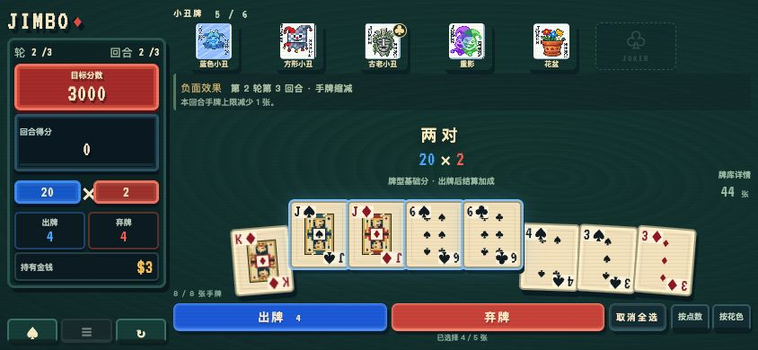

# Jimbo · 深海牌局

**《潜水员戴夫》中 Jimbo’s Game 的非官方复刻。** 以完成任务后再次挑战 Junak 的三轮九回合玩法为基础，支持手机横竖屏、33 张小丑牌、自动存档和 Android 离线游玩。

[](https://github.com/delta-xv/jimbo/actions/workflows/ci.yml)
[](LICENSE)

> An unofficial recreation of **Jimbo’s Game from Dave the Diver**, focused on Junak’s nine-round rematch. Built with React, TypeScript and Capacitor, with Chinese/English UI, mobile layouts and offline Android support.

本项目为爱好者制作，与 MINTROCKET、NEXON、LocalThunk、Playstack 无隶属或认可关系。无需原游戏安装文件。

## 游戏画面



<p align="center">
  
</p>

## 已实现的玩法

- **三轮九回合**：每轮第三回合带随机负面效果，通关或失败都有独立结算。
- **33 张小丑牌、6 个槽位**：筹码与倍率加成、成长、复制、重复触发及牌型规则修改；支持局内拖动换位和左右移动按钮。
- **商店与卡包**：两张明牌、三种规格的小丑卡包、付费刷新、出售和满槽开包后换牌。
- **九种扑克牌型**：从高牌到同花顺；四指、捷径、模糊小丑等会影响判定。
- **完整的信息查看**：牌库状态、逐步计分明细、各牌型本局与本回合的出牌次数。
- **新手教程**：首页三步引导与独立的对子练习。
- **手机适配**：横竖屏布局、取消全选、触屏拖动、小丑成长动效；Android 禁止长按唤起文本选择菜单。
- **自动存档与设置**：中英文界面，音乐和音效独立开关，动画速度、CRT 效果及开局参数。

## 与原作的范围和差异

复刻对象是 **Junak 重赛**。当前没有首次任务的剧情流程、鲛人币下注和与戴夫主游戏的联动，也没有 Balatro 的完整牌组、塔罗牌、星球牌或无尽模式。

为保持规则明确，项目采用以下约定：

- 小丑牌在候选池内等概率抽取，稀有度仅用于展示；同名牌不能重复持有。
- 付费刷新避开上一批明牌，卡包排除已经持有的牌。
- 小丑牌可以在出牌之间和商店内调序；结算期间锁定。
- 快乐安迪被随机禁用时，固定弃牌额度和手牌上限仍然生效。
- 部分随机失效、蓝图兼容性和数值边界采用项目约定；不承诺与原作全部细节一致。

已核实的实机资料、推导部分和项目约定分别列在 [原作核对](docs/parity-reference.md) 中。完整规则见 [游戏规则](docs/rules.md) 与 [小丑牌对照表](docs/jokers.md)。

## 本地运行

需要 **Node.js 22.12 或更高版本**，推荐 Node.js 22 LTS。使用 nvm 时可运行 `nvm use`。

```sh
git clone https://github.com/delta-xv/jimbo.git
cd jimbo
npm ci
npm run dev
```

打开 <http://127.0.0.1:5173>。可使用 `?seed=1` 重现指定初始牌局；玩法设置也会影响对局。

```sh
npm test
npm run build
npm run preview
```

Web 产物位于 `build/`。运行游戏无需账号或后端服务，字体、图片和音频随应用打包。浏览器 PWA 离线缓存尚未实现；**Android APK 安装后可离线游玩**。

项目默认使用 npm 国内镜像，锁文件固定依赖版本。`legacy-peer-deps=true` 用于保持安装参数一致。

## Android 测试包

需要 **JDK 21、Android SDK Platform 36、Build-Tools 36.0.0**。

```sh
npm ci
npm run apk
```

产物位于 `dist/jimbo-0.1.11-debug.apk`，附带 `dist/SHA256SUMS`。这是 debug 测试包。工具链配置、签名与覆盖安装、系统返回键、模拟器验证方式见 [Android 说明](docs/android.md)。

也可以在 [GitHub Actions](https://github.com/delta-xv/jimbo/actions/workflows/ci.yml) 的成功运行中下载 APK artifact；下载 Actions 产物需要登录 GitHub。CI 不部署网站，也不自动创建 Release。

## 验证与已知限制

- 171 项单元和集成测试，覆盖计分、牌型、小丑、商店、存档及交互状态。
- [固定通关动作](tests/fixtures/winning-run.json) 覆盖九回合、八次商店和三次负面效果。
- CI 自动检查第三方说明同步、依赖高危告警、测试、Web 构建和 Android APK 构建。
- 已验证桌面和手机横竖屏布局，包含 320×568 竖屏及 640×272 有效横屏尺寸；设置和牌库等长内容弹窗可内部滚动。
- Android 15 模拟器验证过离线启动、存档恢复、触摸排序、系统返回键和音频生命周期；仍需更多真实手机兼容性反馈。
- 自动测试不代表所有随机种子已经完成难度和平衡验证。旧存档缺失的本回合出牌次数从下一回合开始统计。

反馈问题时，请附上版本、平台或屏幕尺寸、复现步骤；计分问题可附牌型、小丑顺序和计分明细。不要在 Issue 中提交密码、密钥等敏感信息。

## 代码结构

| 目录 | 内容 |
| --- | --- |
| `src/game/` | 牌型、计分、小丑与对局状态机 |
| `src/ui/` | 手牌、小丑、商店、教程与动画 |
| `src/save/`、`src/settings/` | 存档校验与本地设置 |
| `src/i18n/`、`src/audio/` | 双语文本与声音 |
| `android/` | Capacitor Android 工程及仪器测试 |
| `tests/` | 单元、集成测试和通关样例 |

## 许可与致谢

自行编写的代码和文档采用 [MIT](LICENSE) 许可证。**音乐、音效、字体及参考原作形象制作的美术资源不统一适用代码许可证**，具体来源、署名和权利说明见 [第三方说明](THIRD_PARTY_NOTICES.md)。

感谢《潜水员戴夫》与 Balatro 带来的玩法灵感。标准牌算法与测试样例参考 [Browslatro](https://github.com/oreoshake-s-team/browslatro)，音频资源来源于 [Balatro-GBA](https://github.com/GBALATRO/balatro-gba)，并保留各项署名。

构建前会自动运行 `npm run notices:sync`，将说明与许可证同步到 APK/Web 资源；`npm run notices:check` 用于检查同步状态。

更多资料：[开发计划](PLAN.md) · [规则与证据](docs/parity-reference.md) · [上游复用评估](docs/upstream-assessment.md) · [音频](docs/audio.md) · [美术](docs/artwork.md)
