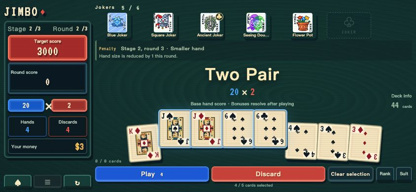
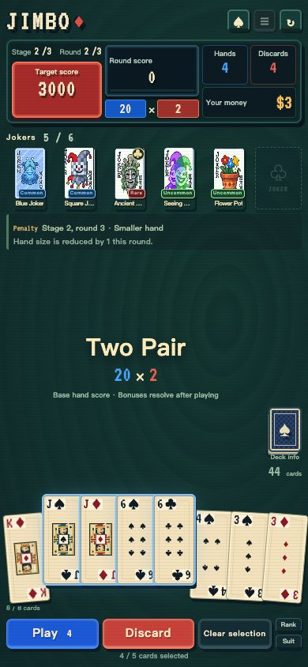

# Jimbo · Deep Sea Poker

[简体中文](README.zh-CN.md)

**An unofficial recreation of Jimbo’s Game from Dave the Diver.** Based on Junak’s nine-round rematch after completing the quest, with 33 Jokers, portrait and landscape layouts, automatic saves, and offline Android play.

[](https://github.com/delta-xv/jimbo/actions/workflows/ci.yml)

## Download for Android

**[Download v1.0.0 APK](https://github.com/delta-xv/jimbo/releases/download/v1.0.0/jimbo-1.0.0-debug.apk)** · [SHA-256 checksums](https://github.com/delta-xv/jimbo/releases/download/v1.0.0/SHA256SUMS)

Play offline after installation, in portrait or landscape. The current APK is a debug test build.

## Screenshots



<p align="center">
  
</p>

## Features

- **Three stages, nine rounds:** a random penalty in the third round of each stage, with dedicated win and loss screens.
- **33 Jokers and 6 slots:** Chips and Mult bonuses, scaling, copying, retriggers, and hand-rule modifiers. Reorder Jokers during play using drag and drop or arrow buttons.
- **Shops and booster packs:** two face-up offers, three pack sizes, paid rerolls, selling, and opening packs before making room for a new Joker.
- **Nine poker hand types:** from High Card to Straight Flush, with modifiers such as Four Fingers, Shortcut, and Smeared Joker.
- **Useful game information:** deck status, step-by-step scoring, and counts of each hand type played during the run and current round.
- **Quick tutorial:** a three-step introduction and a separate practice hand.
- **Mobile controls:** portrait and landscape layouts, clear selection, touch reordering, and Joker growth animations. Long presses do not open Android’s text-selection menu.
- **Saves and settings:** automatic local saves, Chinese and English UI, separate music and sound controls, animation speed, CRT effects, and configurable starting rules.

## Run locally

Requires **Node.js 22.12 or later**. Node.js 22 LTS is recommended; run `nvm use` if you use nvm.

```sh
git clone https://github.com/delta-xv/jimbo.git
cd jimbo
npm ci
npm run dev
```

Open <http://127.0.0.1:5173>. Add `?seed=1` to reproduce a starting run; game settings also affect the run.

```sh
npm test
npm run build
npm run preview
```

The web build is written to `build/`. No account or backend service is required; fonts, images, and audio are bundled. Browser PWA offline caching is not implemented; **the installed Android APK works offline**.

The project uses an npm mirror in China by default and a lockfile for reproducible dependency versions. `legacy-peer-deps=true` keeps installation options consistent.

## Build the Android APK

Requires **JDK 21, Android SDK Platform 36, and Build-Tools 36.0.0**.

```sh
npm ci
npm run apk
```

The output is `dist/jimbo-1.0.0-debug.apk`, accompanied by `dist/SHA256SUMS`. This is a debug test build. See the [Android guide (Chinese)](docs/android.md) for toolchain setup, signing, upgrades, system back-button behavior, and emulator checks.
