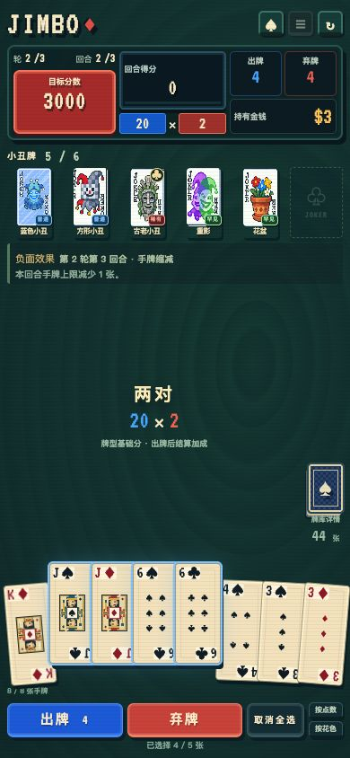

# Jimbo · 深海牌局

**简体中文** | [English](README.md)

**《潜水员戴夫》中 Jimbo’s Game 的非官方复刻。** 以完成任务后再次挑战 Junak 的三轮九回合玩法为基础，支持手机横竖屏、33 张小丑牌、自动存档和 Android 离线游玩。

[](https://github.com/delta-xv/jimbo/actions/workflows/ci.yml)

## 下载 Android APK

**[下载 v1.0.0 APK](https://github.com/delta-xv/jimbo/releases/download/v1.0.0/jimbo-1.0.0-debug.apk)** · [SHA-256 校验文件](https://github.com/delta-xv/jimbo/releases/download/v1.0.0/SHA256SUMS)

安装后可离线游玩，支持手机横竖屏。当前提供 debug 测试包。

## 游戏画面


<p align="center">
  
</p>

## 已实现的玩法

- **三轮九回合**：每轮第三回合带随机负面效果，通关或失败都有独立结算。
- **33 张小丑牌、6 个槽位**：筹码与倍率加成、成长、复制、重复触发及牌型规则修改；支持局内拖动换位和左右移动按钮。
- **商店与卡包**：两张明牌、三种规格的小丑卡包、付费刷新、出售和满槽开包后换牌。
- **九种扑克牌型**：从高牌到同花顺；四指、捷径、模糊小丑等会影响判定。
- **完整的信息查看**：牌库状态、逐步计分明细、各牌型本局与本回合的出牌次数。
- **新手教程**：首页三步引导与独立的对子练习。
- **手机适配**：横竖屏布局、取消全选、触屏拖动、小丑成长动效；Android 禁止长按唤起文本选择菜单。
- **自动存档与设置**：中英文界面，音乐和音效独立开关，动画速度、CRT 效果及开局参数。

## 本地运行

需要 **Node.js 22.12 或更高版本**，推荐 Node.js 22 LTS。使用 nvm 时可运行 `nvm use`。

```sh
git clone https://github.com/delta-xv/jimbo.git
cd jimbo
npm ci
npm run dev
```

打开 <http://127.0.0.1:5173>。可使用 `?seed=1` 重现指定初始牌局；玩法设置也会影响对局。

```sh
npm test
npm run build
npm run preview
```

Web 产物位于 `build/`。运行游戏无需账号或后端服务，字体、图片和音频随应用打包。浏览器 PWA 离线缓存尚未实现；**Android APK 安装后可离线游玩**。

项目默认使用 npm 国内镜像，锁文件固定依赖版本。`legacy-peer-deps=true` 用于保持安装参数一致。

## 自行构建 Android APK

需要 **JDK 21、Android SDK Platform 36、Build-Tools 36.0.0**。

```sh
npm ci
npm run apk
```

产物位于 `dist/jimbo-1.0.0-debug.apk`，附带 `dist/SHA256SUMS`。这是 debug 测试包。工具链配置、签名与覆盖安装、系统返回键、模拟器验证方式见 [Android 说明](docs/android.md)。

## 自行构建 iOS 应用

需要 macOS 和 Xcode 26+。面向 iPhone / iOS 16+，支持离线资源和原生存档。

```sh
npm run ios:sync
npm run ios:open
npm run ios:simulator
npm run ios:unsigned
```

待签名 IPA、校验文件和安装说明位于 `dist/ios/`。在 Xcode 中选择自己的 iPhone 和 Signing Team 后运行安装；免费 Personal Team 签名有效期为 7 天。模拟器检查已通过，签名及真机验收尚未完成。
